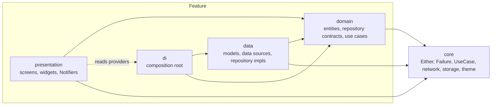
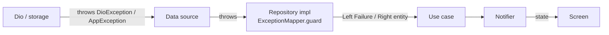
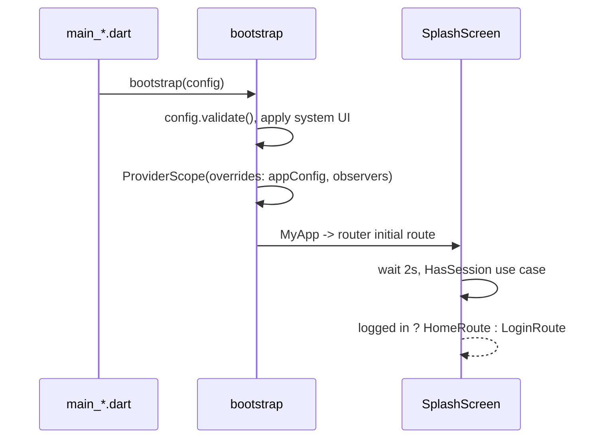
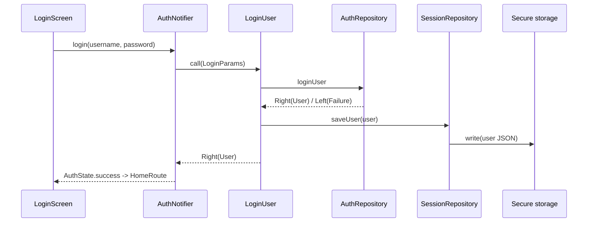

# Project Overview

## 1. What this is

A Flutter template/app demonstrating **Clean Architecture, feature-first**.
It talks to dummyjson.com: login, then a paginated/searchable product list.

Stack: Flutter · Riverpod 3 (`Notifier`) · Dio · Freezed + json_serializable ·
auto_route 11 · flutter_secure_storage · SharedPreferences (non-sensitive) ·
connectivity_plus · logger · mocktail (tests).

## 2. Architecture

### 2.1 Layers and dependency direction



- Arrows mean "imports". **Domain depends on nothing but `core/typedefs`,
  `core/usecases`, `core/result` and `core/errors`.**
- `di/` is the composition root. Presentation may import `di/` only of its
  **own** feature to read providers.

### 2.2 Layer responsibilities

| Layer | Contains | Must NOT |
|---|---|---|
| `domain/entities` | Pure Dart immutable classes (Equatable) and business rules (e.g. `ProductListing.hasMore`) | know JSON, Flutter, Dio, storage |
| `domain/repositories` | Abstract contracts returning `ResultFuture<T>` | expose exceptions or DTOs |
| `domain/usecases` | One class per action, extends `UseCase<T, P>` | import data/presentation |
| `data/models` | Freezed + JSON DTOs with `toEntity()` / `fromEntity()` | leak into domain/presentation |
| `data/datasources` | Talk to API/storage, **throw** `AppException` | return `Either` or entities |
| `data/repositories` | Call data source inside `ExceptionMapper.guard`, map DTO → entity | contain UI logic |
| `presentation` | Screens, widgets, `Notifier`s, UI state | import `data/`, hold business rules, hold UI strings in state |
| `di` | Riverpod providers wiring data source → repository → use case | contain logic |

### 2.3 Folder map

```
lib/
├── app/            app.dart (MaterialApp.router, session-expiry listener), bootstrap, observers
├── config/         AppConfig + dev/staging/prod configs, config provider
├── core/
│   ├── constants/  api, colors, strings, storage keys, routes
│   ├── errors/     exceptions (data), failures (domain), exception_mapper, error_handler
│   ├── result/     either.dart (Either, Left, Right, map, getOrThrow)
│   ├── typedefs/   ResultFuture<T>, Result<T>, DataMap
│   ├── usecases/   UseCase<T, P>, NoParams
│   ├── network/    ApiClient (Dio), ApiService, interceptors, event bus
│   ├── storage/    LocalStorageService (SharedPreferences), SecureStorageService (Keychain/Keystore)
│   ├── services/   connectivity, haptics, micro-interactions
│   ├── routes/     auto_route AppRouter
│   ├── theme/ widgets/ utils/ logging/ monitoring/ system/
├── features/
│   ├── authentication/ {data, di, domain, presentation}
│   ├── session/        {data, di, domain, presentation}
│   ├── home/           {data, di, domain, presentation}
│   └── splash/         {presentation}
├── flavors/        main_dev.dart, main_staging.dart, main_prod.dart
├── shared/providers/app_provider.dart   app-wide infrastructure providers
└── main.dart       defaults to dev flavor
test/
├── architecture/   enforces the dependency rules
├── core/  features/  flavor_config_test.dart
```

### 2.4 Error model



- `AppException` (core/errors/exceptions.dart): data-layer, thrown.
- `Failure` (core/errors/failures.dart): domain-layer value, returned in `Left`.
- `ExceptionMapper.guard(() async => ...)` is the only place exceptions become
  failures.

## 3. Runtime flows

### 3.1 App start



### 3.2 Session lifecycle (how the session is maintained)

| Step | What happens | Where |
|---|---|---|
| Login | `LoginParams` → `LoginUser` use case → `AuthenticationRepository.loginUser` → `POST /auth/login` → `AuthUserModel` → `User` entity | `features/authentication` |
| Start session | Same use case then calls `SessionRepository.saveUser`; user JSON (including `token`) is written to **secure storage** under `StorageKeys.user` | `features/session/data` |
| Header set | Login data source calls `ApiService.updateHeader({Authorization: token})` | `auth_remote_data_source.dart` |
| Every request | `AuthInterceptor` reads `access_token` or the `token` inside the stored user and sets `Authorization: Bearer …` | `core/network/interceptors/auth_interceptor.dart` |
| App relaunch | Splash runs `HasSession`; if a user exists go Home, else Login | `features/splash` |
| Current user | `currentUserProvider` (`GetCurrentUser`) feeds the drawer | `session/presentation` |
| Logout | `logoutProvider` → `DeleteSession` use case clears secure storage; router resets to Login | `HomeDrawer`, `session_provider.dart` |
| Expiry (HTTP 401) | `GlobalErrorInterceptor` publishes `NetworkEventType.unauthorized` on `NetworkEventBus`; `app.dart` listens, calls `logoutProvider`, `replaceAll([LoginRoute])`, shows a snackbar | `core/network`, `app/app.dart` |



Rules for the session: tokens live **only** in secure storage; never in
`SharedPreferences`, logs or state. Only the `session` feature reads/writes the
stored user; other features use `logoutProvider` / `currentUserProvider`.

### 3.3 Product list (pagination)

`HomeNotifier` keeps the current `ProductListing`. `FetchProducts` /
`SearchProducts` receive it, request `skip = listing.nextSkip`,
`limit = ProductListing.pageSize` and return the listing with the page
appended. When `hasMore` is false the use case does not call the repository and
the notifier emits `HomeConcreteState.endReached` (UI shows the snackbar text).

## 4. Cross-cutting concerns

| Concern | Implementation |
|---|---|
| Config / flavors | `AppConfig` (+ `validate()`), entry points per flavor |
| Networking | `ApiClient` (Dio) with Connectivity, Auth, GlobalError, Log interceptors; test mode skips interceptors |
| Connectivity | `ConnectivityService` → `connectivityStatusProvider` → `InternetStatusBanner` |
| Theme | `appThemeProvider` (`Notifier<ThemeMode>`), persisted in SharedPreferences |
| Logging / monitoring | `AppLogger`; `ErrorReporter` (no-op by default, override in `errorReporterProvider`) |
| Routing | auto_route 11, `RootStackRouter`, routes: Splash (initial), Login, Home |
| Codegen | Freezed, json_serializable, auto_route_generator via build_runner |

## 5. Known gaps / roadmap

- The staging URL in `app_config.dart` is a placeholder; prod points at the
  demo backend. Set real URLs before shipping.
- No offline cache / `NetworkInfo` (removed as unused); add when required.
- No l10n, analytics or feature-flag abstractions yet.
- Splash has no domain/data layer by design (UI-only, calls `HasSession`).
